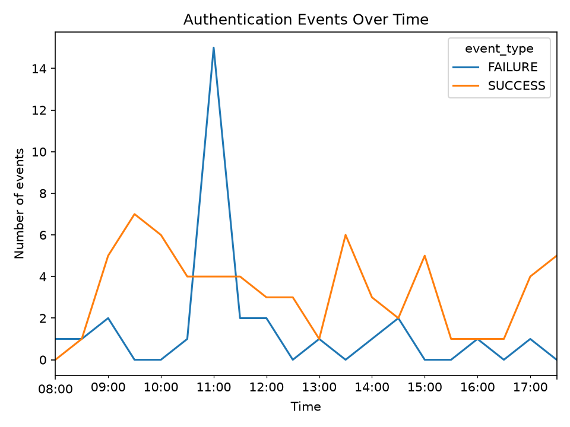
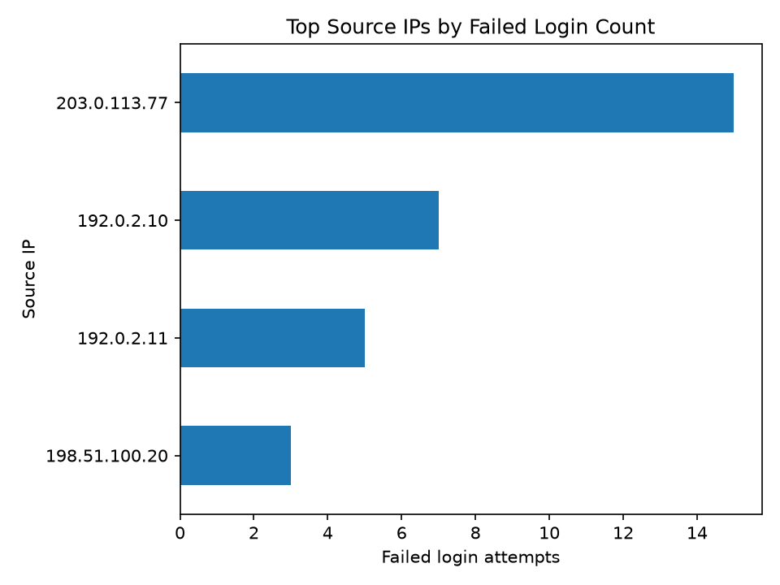

# Mini SOC Investigation Lab

## Overview

A beginner-friendly Security Operations Center (SOC) investigation project that analyzes simulated authentication logs to identify suspicious login activity.

Built with Python, pandas, and matplotlib, this project demonstrates authentication log analysis, failed-login detection, time-window-based event correlation, investigation reporting, and data visualization.

**Disclaimer:** All authentication events are simulated. This project does not analyze real user accounts or represent a confirmed security incident.

## Objectives

- Generate simulated authentication logs.
- Analyze successful and failed login attempts.
- Identify source IP addresses with repeated failed logins.
- Detect successful logins preceded by repeated failures within a 15-minute window.
- Generate CSV investigation results and visualizations.
- Document findings and recommended response actions.

## Tools and Technologies

- Python
- pandas
- matplotlib
- CSV log analysis
- Git and GitHub

## Project Structure

```text
Mini-SOC-Lab/
├── data/
│   └── auth_logs.csv
├── src/
│   ├── generate_logs.py
│   └── analyze_logs.py
├── outputs/
│   ├── failed_logins_by_ip.csv
│   ├── failed_logins_by_user.csv
│   ├── success_after_failures.csv
│   ├── failed_logins_by_ip.png
│   └── authentication_timeline.png
├── report/
│   └── incident_report.md
└── README.md
```

## Detection Logic

The analysis script:

1. Loads authentication events and validates required columns.
2. Counts failed login attempts by source IP and username.
3. Identifies IP addresses with at least five failed login attempts overall.
4. Examines successful logins from those IP addresses.
5. Checks whether at least five failed login attempts occurred within the 15 minutes preceding a successful login from the same IP.
6. Exports investigation results and visualizations.

This time-window-based correlation provides more context than simply counting failed login attempts across the entire dataset.

A flagged pattern is an investigative lead, not proof of malicious activity.

## Sample Investigation Findings

The simulated dataset contains 96 authentication events:

- 66 successful logins
- 30 failed logins
- 15 total failed attempts from `203.0.113.77`
- 14 failed attempts within the 15-minute detection window
- Successful login to the simulated `admin` account at 11:16 AM on October 20, 2026

**Detection result:** The source IP `203.0.113.77` was flagged because 14 failed login attempts occurred within the 15 minutes preceding a successful admin login.

No real account compromise was established.

## How to Run

### 1. Create and activate a virtual environment

```bash
python3 -m venv .venv
source .venv/bin/activate
```

### 2. Install dependencies

```bash
python -m pip install pandas matplotlib
```

### 3. Generate simulated authentication logs

```bash
python src/generate_logs.py
```

### 4. Analyze the logs

```bash
python src/analyze_logs.py
```

Review the generated CSV files and charts in the `outputs/` folder.

## Investigation Report

See [Incident Investigation Report](report/incident_report.md) for the investigation summary, detection methodology, evidence, severity assessment, limitations, and recommended response.

## Visualizations

### Authentication Events Over Time

This chart shows the distribution of simulated successful and failed authentication events over time.



### Failed Logins by Source IP

This chart compares failed login counts by source IP and helps highlight sources that may warrant further investigation.



## Future Improvements

- Add configurable detection thresholds.
- Implement additional authentication detection rules.
- Integrate with a SIEM such as Splunk.
- Add automated tests and structured alert output.
- Expand the investigation to include additional log sources.

## Disclaimer

This project uses simulated data for educational and portfolio purposes only. The IP addresses used are documentation-reserved example addresses.